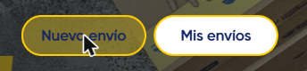

# Auditoría: estados interactivos — Figma vs. producción MiCorreo

- **Fuente de producción:** https://micorreo.correoargentino.com.ar/landing (sesión iniciada, Chrome)
- **Método:** lectura del CSS que genera MUI en la página (reglas `:hover`, `:active`, `.Mui-focusVisible`, `.Mui-disabled`), valores computados con el mouse encima y simulación del clic (mousedown) para ver el pressed
- **Fuente de diseño:** Figma `Buttons v1.0` (49:4524) y `Text Fields` (183:2366)
- **Fecha:** 2026-11-04
- **Alcance:** sólo los elementos visibles en la landing. Falta relevar el resto de las pantallas de MiCorreo.

---

## 1. Botón Primary (amarillo) — p. ej. "Nuevo envío" en la tarjeta del hero

| Estado | Figma (v1.0) | Producción | Diferencia |
|---|---|---|---|
| Reposo | fondo `#FFCE00`, sin borde, pill, alto 40 / 48, padding 20 | fondo `#FFCE00`, **borde 2px `#FFCE00`**, radio 24, **alto 44**, **padding 6/16** | borde que no está en Figma (en reposo no se nota porque es del mismo color); alto y padding distintos |
| Hover | fondo **`#E8BB00`** (sólido) | fondo **`rgba(255, 206, 0, 0.6)`** (amarillo al 60 %) + el borde de 2px sigue al 100 % | Figma oscurece; producción **vuelve transparente** el fondo, y el borde queda como un anillo visible |
| Pressed | fondo **`#B59200`** | igual que hover + **onda (ripple) de MUI**: círculo del color del texto (`#152663`) al ~30 % de opacidad, que se expande desde el clic | el "más transparente" que se ve es el ripple azul sobre el fondo al 60 % |
| Focus (teclado) | contorno 2px `#FFF0B0` | sombra de elevación de MUI (por defecto) | distinto |
| Disabled | fondo `#D9D9D9`, texto `#A7A7A7` | fondo **`rgba(255, 206, 0, 0.6)`**, texto `#152663` | ❗ **disabled se ve igual que hover**: no se distingue un botón deshabilitado |

*Hover: "Nuevo envío" con fondo al 60 % y borde amarillo de 2px.*

*Pressed: además aparece el ripple azul.*

**Por qué el fondo transparente es un problema:** el color final depende de lo que haya detrás. Sobre la foto oscura del hero se ve amarillo sucio. Sobre blanco equivaldría a `#FFE266`. No es un valor estable que se pueda poner en el design system.

## 2. Botón Secondary (outlined) — "Mis envíos"

| Estado | Figma (v1.0) | Producción | Diferencia |
|---|---|---|---|
| Reposo | fondo blanco, **borde 1px** `#FFCE00`, texto `#152663` | fondo blanco, **borde 2px** `#FFCE00`, texto `#152663`, radio 24, alto 44 | grosor del borde |
| Hover | **borde `#E8BB00`** | borde igual; **texto `#6A78A8`** (azul aclarado) | cambia otra propiedad, y `#6A78A8` no es un token (el más cercano es secondary-300 `#626E96`) |
| Pressed | borde `#B59200` | ripple azul de MUI | distinto |

## 3. Botones de texto del header — "Nuevo envío", "Mi cuenta"

| Estado | Figma | Producción |
|---|---|---|
| Hover | — (no hay componente para botones de header) | **ninguno**: hay una regla con `#E6BC00`, pero otra posterior la pisa con `transparent` |
| Forma | — | radio 8, alto 42, texto `#191919` |

El botón de menú (hamburguesa) tampoco cambia al pasar el mouse.

## 4. Input — "Gestionar devolución"

| Estado | Figma (Text Fields) | Producción | Diferencia |
|---|---|---|---|
| Reposo | borde `#D9D9D9`, **radio 4** | borde `#D9D9D9`, **radio 8** | radio |
| Hover | no definido | borde `#E0E0E0` | casi invisible (es más claro que el de reposo) |
| Focus | borde **`#2196F3`** 1px | borde **`#E0E0E0`** 1px | ❗ **el foco no se ve**. Existe una clase `specialOutlined` con `#2196F3`, pero este input no la usa |
| Error | `#F03131` | `#D32F2F` (rojo por defecto de MUI) | color |
| Disabled | texto `#A7A7A7` | fondo `#EEEEEE` | distinto |

## 5. Otros

- **Links** (`MuiLink`, p. ej. "Cerrar sesión"): el hover sólo cambia el color del subrayado.
- **Puntos del carrusel:** hover = opacidad 0,8.

---

## Hallazgo de estructura: la paleta del código está invertida

En producción, el botón amarillo usa `MuiButton-containedSecondary`. Es decir, en el theme de los DEVs **el amarillo es `secondary`**. En el `theme.ts` del paquete, el amarillo es `primary` (como en Figma, donde `Primary` = amarillo).
→ Antes de adoptar `themeWeb` hay que alinear esto, o el código existente con `color="secondary"` va a cambiar de color.

## Conclusiones

1. **El patrón de producción para hover y pressed no sale de Figma:** son defaults de MUI (opacidad, ripple, elevación) mezclados con overrides parciales. Por eso no coinciden con nada del design system.
2. **Hay tres problemas de accesibilidad y uso:** disabled igual a hover en el Primary, el foco de los inputs que no se ve, y el foco de los botones que depende de una sombra.
3. **Figma tampoco está completo:** el Tertiary (link) no tiene estados, y faltan hover y focus en inputs, switch, tabs, chips y en los botones de header.

## Decisión (2026-11-04)

**Para los estados que Figma no resuelve, manda producción.** Aplicado en Figma, `Buttons v1.0` (49:4524), en 21 variantes:
- Primary: borde 2px `#FFCE00`; hover `#FFCE00` al 60 %; pressed = hover + capa `#152663` al 30 %.
- Secondary: borde de 2px en todos los estados; hover y pressed con texto e ícono `#6A78A8`; pressed con la misma capa al 30 %.
- Sin cambios: Disabled (el de producción es igual al hover), Focus y Tertiary.
- Se crearon 3 variables nuevas en `Specific/Buttons/`, para no tocar las de hover y pressed existentes, que usan otros 6 nodos fuera del componente.
- `themeWeb` quedó alineado con esto.

## Propuesta original (referencia)

| Tema | Opción A — Figma manda (recomendada) | Opción B — Producción manda |
|---|---|---|
| Hover | colores sólidos de la escala: Primary `#E8BB00`, Secondary borde `#E8BB00` | documentar el 60 % de opacidad en Figma |
| Pressed | `#B59200` sólido, **sin ripple** (`disableRipple`) | documentar el ripple |
| Borde 2px | no hay borde en Primary; Secondary con 1px | sumar el borde de 2px a Figma |
| Disabled | `#D9D9D9` / `#A7A7A7` | ❌ no recomendable: hoy no se distingue |
| Focus | contorno 2px visible en todos los interactivos | — |

Recomiendo la **A**: los valores de Figma son sólidos, salen de la escala de tokens y son estables sobre cualquier fondo. La opacidad del 60 % cambia según lo que haya detrás.

**Además, en Figma (sea cual sea la opción):** completar la matriz de estados (enabled, hover, pressed, focus y disabled) de todos los componentes interactivos. Ver `design-system-handoff/INCONSISTENCIAS.md` #12.
