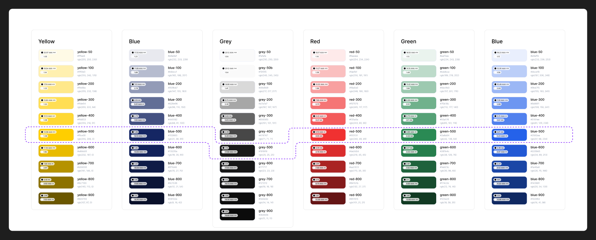

# Inventario del design system → MUI

Fuente: Figma `Design System` (kOuwVxF91lktyHh1DSVuAr), página `🎨 Documentación` (13:37). Extracción: 2026-11-04.
Leyenda: ✅ mapea directo a MUI con el theme · 🔧 MUI + composición o ajuste · 🧩 componente propio · ⛔ deprecado

## Fundamentos

| Fundamento | En Figma | En el paquete |
|---|---|---|
| Colores | 69 variables primitivas (Primary, Secondary, Neutral, Error, Success, Link) | `tokens.json → color`, `theme.palette` |
| Colores semánticos | 55 variables (Background, Text, Icon, Stroke, status) | `tokens.json → semantic` |
| Colores por componente | 109 variables (Buttons, Buttons 2, Inputs, Tabs, Radio, Switch, Check-box) | aplicadas en `theme.components` |
| Tipografía | familia Gilroy + 8 tamaños como variables; escala h1–h5 y text-large/regular/small **sólo como ejemplos** (no hay Text Styles) | `tokens.json → typography`, `theme.typography` |
| Radios | 8 / 16 / 24 / 32 / 40 / 9999 | `tokens.radius`, `shape.borderRadius = 8` |
| Espaciado | 13 pasos, base 4 | `tokens.spacing` (theme mantiene base 8 de MUI) |
| Sombras | ninguna definida | — |
| Íconos | 1510 Lucide + íconos propios de Correo | `lucide-react` |

## Componentes

| Componente Figma | Nodo | Variantes | MUI | Estado | Doc |
|---|---|---|---|---|---|
| Buttons v1.0 — **web MiCorreo** | 49:4524 | 45 | `Button` con `themeWeb` | ✅ | [buttons.md](components/buttons.md) |
| Buttons 2.0 — **backoffices** | 248:870 | 90 | `Button` con `themeBackoffice` | ✅ | [buttons.md](components/buttons.md) |
| Text Fields | 183:2366 | 14 | `TextField` outlined | ✅ | [inputs.md](components/inputs.md) |
| Select | 183:3155 | 16 | `TextField select` / `Select` | ✅ | [inputs.md](components/inputs.md) |
| Checkbox | 231:940 | 6 (v1 y v2) | `Checkbox` | ✅ | [selection-controls.md](components/selection-controls.md) |
| Radio buttons | 231:829 | 3 | `Radio` | ✅ | [selection-controls.md](components/selection-controls.md) |
| Switch | 35:262 | 2 | `Switch` | ✅ | [selection-controls.md](components/selection-controls.md) |
| Tabs / Tabs-individual | 151:721 / 151:709 | 3 | `Tabs` + `Tab` | ✅ | [tabs-chip.md](components/tabs-chip.md) |
| Chip | 1669:1565 | 18 | `Chip` (+ `Menu` en Select) | 🔧 | [tabs-chip.md](components/tabs-chip.md) |
| modal | 1029:1400 | 8 | `Dialog` | 🔧 | [feedback.md](components/feedback.md) |
| modal deprecado | 772:1527 | 2 | — | ⛔ | — |
| icon for empy state | 1033:1736 | 4 | ícono en círculo | 🧩 | [product-specific.md](components/product-specific.md) |
| tooltip | 772:1566 | 1 | `Tooltip` | ✅ | [feedback.md](components/feedback.md) |
| Header-base / Header-MiCorreo | 367:3397 / 837:1725 | 4 / 1 | `AppBar` + `Toolbar` | 🔧 | [layout-navigation.md](components/layout-navigation.md) |
| Opciones sideBar (Menú lateral 2.0) | 696:1110 | 3 | `Drawer` + `ListItemButton` | 🔧 | [layout-navigation.md](components/layout-navigation.md) |
| Menú lateral 1.0 (Option 1–4, Aside, Sidebar-MiCorreo) | 220:1802 | — | `Drawer` | ⚠ versión anterior | [layout-navigation.md](components/layout-navigation.md) |
| Componente tablas / Paginador | 367:2110 / 1562:1461 | 2 | `Table` + `TablePagination` | 🔧 | [layout-navigation.md](components/layout-navigation.md) |
| Mini step / steps mini stepper | 1639:1499 / 1639:1502 | 6 / 1 | propio | 🧩 | [layout-navigation.md](components/layout-navigation.md) |
| Calendario | 219:732 | 2 | `DateCalendar` (MUI X) | 🔧 | [product-specific.md](components/product-specific.md) |
| Filtros y Filtros específicos | 248:1410 / 367:2093 | — | composición | 🧩 | [product-specific.md](components/product-specific.md) |
| mis envios card y relacionados | 837:1117 | 4 | `Card` | 🧩 | [product-specific.md](components/product-specific.md) |
| Brand (Logo, Iso, Imagen) | 49:151 | — | SVG | — | [product-specific.md](components/product-specific.md) |

## Sin equivalente en Figma (MUI los trae, pero no están diseñados)

Alert / Snackbar, Breadcrumbs, Accordion, Avatar, Badge, Progress, Skeleton, Autocomplete, Slider. Si se usan, toman el theme pero **no tienen diseño aprobado**.
