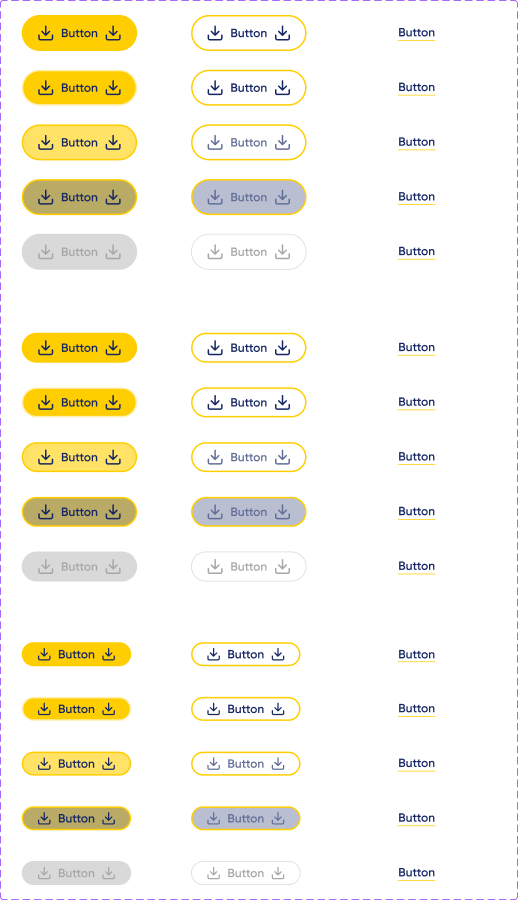
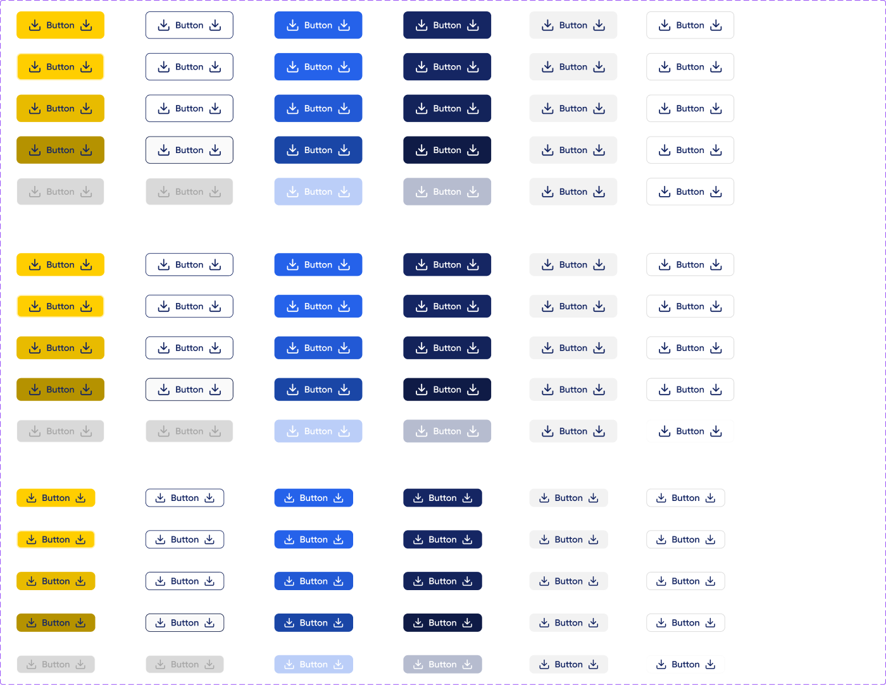

# Button

El design system es de todo Correo, pero **los botones cambian según la plataforma** (confirmado por UX, 2026-11-04):

| Plataforma | Componente Figma | Theme |
|---|---|---|
| **Web pública MiCorreo** | `Buttons v1.0` · [49:4524](https://www.figma.com/design/kOuwVxF91lktyHh1DSVuAr/Design-System?node-id=49-4524) | `themeWeb` |
| **Backoffices** | `Buttons 2.0` · [248:870](https://www.figma.com/design/kOuwVxF91lktyHh1DSVuAr/Design-System?node-id=248-870) | `themeBackoffice` |

No son una versión vieja y una nueva: son **dos familias vigentes**. En MiCorreo no se usan los botones 2.0, por ahora.

El código usa siempre `<Button>`, y el theme de cada app le da el estilo correcto. Lo único que cambia es qué combinaciones de props están permitidas.

---

## Web MiCorreo — Buttons v1.0



| Figma `Version` | MUI | Fondo | Texto | Borde |
|---|---|---|---|---|
| Primary | `variant="contained"` (por defecto) | `#FFCE00` | `#152663` | — |
| Secondary | `variant="outlined"` | `#FFFFFF` | `#152663` | 1px **`#FFCE00`** |
| Tertiary | `variant="text"` | — | `#152663` | línea inferior 1px `#FFCE00` (tipo link) |

```tsx
<Button>Continuar</Button>
<Button variant="outlined">Volver</Button>
<Button variant="text">Ver detalle</Button>
```

**Forma:** pill (radio 9999). **Padding horizontal:** 20 en los tres tamaños; Tertiary, 24.

Hover y pressed se actualizaron en Figma el 2026-11-04 con los valores de producción:

| Estado | Primary | Secondary | Tertiary |
|---|---|---|---|
| Enabled | bg `#FFCE00` + borde 2px `#FFCE00` | bg blanco + borde **2px** `#FFCE00` | texto navy + línea amarilla |
| Hover | bg **`rgba(255,206,0,0.6)`** + borde 2px `#FFCE00` | borde igual, texto e ícono **`#626E96`** (secondary-300) | ⚠ igual a enabled |
| Pressed | hover + capa `#152663` al 30 % (en código, el **ripple** de MUI) | hover + capa al 30 % (ripple) | ⚠ igual a enabled |
| Focus | contorno 2px `#FFF0B0` | ⚠ igual a enabled | ⚠ igual a enabled |
| Disabled | bg `#D9D9D9`, texto `#A7A7A7` | borde `#D9D9D9`, texto `#A7A7A7` | ⚠ igual a enabled |

### Tokens de componente (Figma → `Specific/Buttons/`)

| Token | Apunta a | Valor |
|---|---|---|
| `Primary/Background/button-primary-bakcground-default` | `color-background-primaryBrand` | `#FFCE00` |
| `Primary/Background/button-primary-bakcground-hover` | `Primitive/color-primary-500-a60` | `#FFCE00` al 60 % |
| `Primary/Background/button-primary-bakcground-pressed` | `Primitive/color-primary-500-a60` (+ capa) | `#FFCE00` al 60 % |
| `Primary/Stroke/button-primary-stroke-default` | `Stroke/color-stroke-primary` | `#FFCE00` |
| `Seconadry/Stroke/button-secondary-stroke-hover` / `-pressed` | `Stroke/color-stroke-primary` | `#FFCE00` |
| `Seconadry/Text/button-secondary-text-hover` | `Primitive/color-secondary-300` | `#626E96` |
| `Pressed/button-pressed-overlay` | `Primitive/color-secondary-500-a30` | `#152663` al 30 % |
| `Stroke/button-border-width` | — | 2 |

Disabled **no** se copió de producción, porque allí es igual al hover. El texto hover usa `secondary-300` en lugar del `#6A78A8` de producción (ΔE 6; mejora el contraste de 4,32 a 5,01).

⚠ Tertiary no tiene estados en Figma: el theme propone hover (línea `#E8BB00`) y disabled (texto `#A7A7A7`). El foco de teclado usa contorno 2px en todas las versiones.

**Fuente de los estados:** producción (decisión de UX del 2026-11-04). `themeWeb` reproduce el borde de 2px, el hover al 60 % y deja activo el ripple de MUI para el pressed. Diferencias que quedan con producción: el disabled (se usa el de Figma) y el tamaño (Figma 40/48 vs. producción 44). Detalle en `../auditoria-brecha/estados-interactivos-micorreo.md`.

**Regla provisoria de uso (UX, 2026-11-06):** en MiCorreo, Primary, Secondary y Tertiary salen de v1.0. De Buttons 2.0 se pueden usar las versiones que v1.0 no tiene: dark, light, light border, **borderless**, **borderless link** y sólo ícono. No se mezclan dos Primary de familias distintas en una misma pantalla.

---

## Backoffices — Buttons 2.0



| Figma `Version` | MUI | Fondo | Texto | Borde |
|---|---|---|---|---|
| Primary | `variant="contained"` (por defecto) | `#FFCE00` | `#152663` | — |
| Secondary | `variant="outlined"` | `#FFFFFF` | `#152663` | 1px **`#152663`** |
| Tertiary | `variant="contained" color="tertiary"` | `#2562EA` | `#FFFFFF` | — |
| dark | `variant="contained" color="secondary"` | `#152663` | `#FFFFFF` | — |
| light | `variant="light"` | `#F2F2F2` | `#152663` | — |
| light border | `variant="lightBorder"` | `#FFFFFF` | `#152663` | 1px `#D9D9D9` |

```tsx
<Button>Guardar</Button>
<Button variant="outlined">Cancelar</Button>
<Button color="tertiary" size="small" startIcon={<Download />}>Exportar</Button>
<Button variant="lightBorder" endIcon={<ChevronDown />}>Más acciones</Button>
```

**Forma:** radio 8. **Padding horizontal:** 20 / 20 / 16 (L / M / S).

| Estado | Primary | Secondary | Tertiary | dark |
|---|---|---|---|---|
| Hover | bg `#E8BB00` | borde `#13235A` | bg `#2259D5` | bg `#13235A` |
| Pressed | bg `#B59200` | borde `#0F1B46`, bg `#FAFAFA` | bg `#1A46A6` | bg `#0F1B46` |
| Focus | contorno 2px `#FFF0B0` | ⚠ igual a enabled | ⚠ igual a enabled | ⚠ igual a enabled |
| Disabled | bg `#FFFAE6` | bg `#D9D9D9`, borde `#FAFAFA` | bg `#BBCEF8` | bg `#B6BCCF` |

⚠ light y light border no cambian entre estados en Figma. `variant="text"` no existe en backoffice.

### borderless y borderless link (2026-11-06)

Botón de texto **sin fondo, sin borde y sin padding**, para acciones dentro de tarjetas y filas («Eliminar», «Editar», «Ver desglose»). Conserva el alto de cada tamaño (48, 40 y 32) y el radio 8. Se usa **en web y en backoffice**.

| Figma `Version` | MUI | Texto e ícono | Hover | Focus | Disabled |
|---|---|---|---|---|---|
| borderless | `variant="borderless"` | navy (`Text/Brand/color-text-secondaryBrand`, `Icon/color-icon-secondary`) | fondo `color-background-hover` | fondo `color-background-focus` | texto e ícono `#A7A7A7` |
| borderless link | `variant="borderless" color="tertiary"` | azul `#2562EA` (`Text/Link/link text acent`, `Icon/color-icon-link`) | fondo `color-background-hover` + texto e ícono `#143681` (`link text hover`, `color-icon-link-hover`) | fondo `color-background-focus` | texto e ícono `#A7A7A7` |

```tsx
<Button variant="borderless" size="small" startIcon={<Trash2 />}>Eliminar artículo</Button>
<Button variant="borderless" color="tertiary" size="small">Editar</Button>
```

Pressed: en Figma usa el mismo fondo que hover; en código lo da el ripple.

---

## Común a las dos plataformas

| Figma `Size` | MUI `size` | Alto | Texto |
|---|---|---|---|
| L | `large` | 48 | Gilroy SemiBold 16 |
| M | `medium` (por defecto) | 40 | Gilroy SemiBold 16 |
| S | `small` | 32 | Gilroy SemiBold 16 |

| Propiedad de Figma | MUI |
|---|---|
| `Text` | `children` |
| `show left icon` + ícono | `startIcon` |
| `show right icon` + ícono | `endIcon` |
| `show text = false` (2.0) | `<IconButton>` |

Íconos: `lucide-react`, mismo color que el texto. Separación ícono-texto: 8.

## Cómo elegir el theme en cada app

```tsx
// app MiCorreo
import { themeWeb } from '@/design-system/theme';
// app backoffice
import { themeBackoffice } from '@/design-system/theme';
```

Si hay una librería de componentes compartida entre apps, no debe fijar un theme: lo provee cada app.
