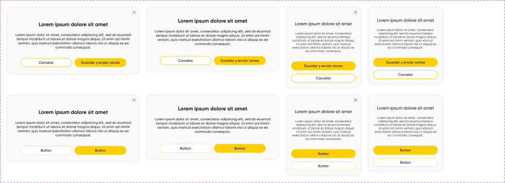

# Modal y Tooltip

## Modal

**Figma:** `modal` · [1029:1400](https://www.figma.com/design/kOuwVxF91lktyHh1DSVuAr/Design-System?node-id=1029-1400) · 8 variantes
**Deprecado:** `modal deprecado` · 772:1527 — no usar
**MUI:** `<Dialog>` + `<DialogTitle>` + `<DialogContent>` + `<DialogActions>`

| | Desktop | Responsive |
|---|---|---|
| Ancho | 600 | 340 |
| Radio | 24 | 24 |
| Fondo | `#FAFAFA` | `#FAFAFA` |
| Título | Gilroy Bold 24 | Gilroy Medium 20 |
| Cuerpo | Gilroy Medium 16 | Gilroy Regular 14 |
| Botones | Buttons, tamaño M | Buttons, apilados |

| Propiedad de Figma | Código |
|---|---|
| `Mandatorio=true` | sin opción "No volver a mostrar" y sin cerrar con clic afuera (`onClose` ignora `backdropClick`) |
| `no volver a mostrar` | `<FormControlLabel control={<Checkbox/>} label="No volver a mostrar" />` |
| `show close button` | `IconButton` con ícono X arriba a la derecha |
| `show icon` | ícono ilustrativo (`icon for empy state`, tamaños S/M/L/XL) arriba del título |
| `Free slot` / `slot 1-3` | contenido libre en `DialogContent` |
| `Version=V1 (Prod)` vs `V2 (Buttons corrected)` | V2 usa Buttons 2.0 (backoffice). ⚠ Sin confirmar si V1 corresponde a MiCorreo; los botones del modal toman el estilo del theme de cada app |

Overlay: `#191919` al 50 % (`color-background-overlay`).
⚠ El borde (`#000000` 18 %) y el fondo (`G1`) usan variables de otra librería que ya no existen en este archivo.

## Tooltip

**Figma:** `tooltip` (V1 PROD) · [772:1566](https://www.figma.com/design/kOuwVxF91lktyHh1DSVuAr/Design-System?node-id=772-1566) · **MUI:** `<Tooltip>`

Fondo `#292929` ⚠ (no es token; el más cercano es neutral-500 `#191919`), texto blanco Gilroy Regular 12, padding 6/8, radio 2. Sin flecha.
