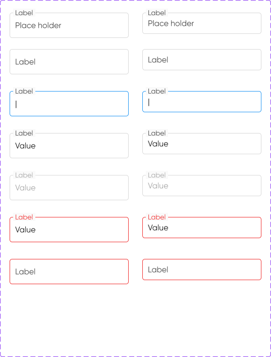
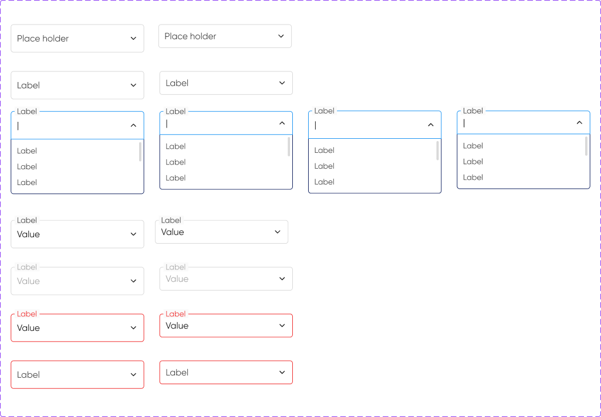

# Text Field y Select

**Figma:** `Text Fields` · [183:2366](https://www.figma.com/design/kOuwVxF91lktyHh1DSVuAr/Design-System?node-id=183-2366) · `Select` · [183:3155](https://www.figma.com/design/kOuwVxF91lktyHh1DSVuAr/Design-System?node-id=183-3155)
**MUI:** `<TextField variant="outlined">`, `<TextField select>` o `<Select>` · estilos en `theme.ts → MuiOutlinedInput, MuiInputLabel, MuiFormHelperText`




## Anatomía

Es el patrón *outlined* de MUI: la etiqueta flota sobre el borde superior.

| Parte | Valor |
|---|---|
| Caja | radio 4 ⚠ (valor correcto según UX, 2026-11-11; falta el token `radius-xs`, tarea F4), fondo `#FFFFFF`, borde 1px |
| Padding interno | 10 horizontal |
| Valor | Gilroy Regular 16, `#191919` (input-text-value) |
| Placeholder | Gilroy Regular 16, `#474747` (input-text-placeholder) |
| Etiqueta flotante | Gilroy Regular 14, `#474747`, fondo `#FAFAFA` con 4px de padding horizontal |
| Texto de ayuda (Support text) | Gilroy Regular 14, `#474747` |
| Separación caja / ayuda | 8 |

## Tamaños

| Figma `Size` | MUI `size` | Alto |
|---|---|---|
| Medium | `medium` | 48 |
| Small | `small` | 40 |

## Estados (Figma `Type`)

| Figma | MUI | Borde | Etiqueta | Valor |
|---|---|---|---|---|
| Default | — | `#D9D9D9` | `#474747` | placeholder `#474747` |
| Active | `focused` | `#2196F3` (1px) | `#474747` | `#191919` |
| Value | con `value` | `#D9D9D9` | `#474747` | `#191919` |
| Disabled | `disabled` | `#D9D9D9` | `#A7A7A7` | `#A7A7A7` |
| Error | `error` | `#F03131` | `#F03131` | `#191919` |
| Default error | `error` sin valor | `#F03131` | `#F03131` | — |

⚠ Figma no define el estado hover. El theme usa `#A7A7A7` como propuesta.

## Propiedades de Figma → props de MUI

| Figma | MUI |
|---|---|
| `Label` | `label` |
| `Place holder text` | `placeholder` |
| `Value2` / `Value` | `value` |
| `Support text` | `helperText` |
| `Obligatorio` / `obligatorio input` | `required` (agrega `*`) |
| `Left icon` + `left icon swap` | `slotProps.input.startAdornment` (v6+) / `InputProps.startAdornment` (v5) |
| `Right icon` + `right icon swap` | `endAdornment` |
| `Left/Righ adornments` | `InputAdornment` con texto (p. ej. "$", "kg") |
| `Slot right` | `endAdornment` con contenido libre |

## Select

Misma caja que Text Field. Al abrirse (`Type=Active`), el menú se despliega debajo con opciones de Gilroy Regular 16. `Max height=True` = lista con scroll.

```tsx
<TextField select label="Provincia" value={prov} onChange={...} helperText="Seleccioná una opción">
  {provincias.map(p => <MenuItem key={p} value={p}>{p}</MenuItem>)}
</TextField>
```
