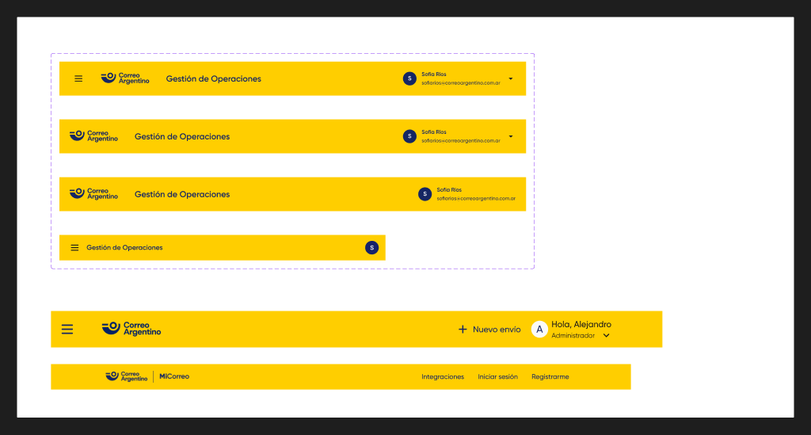
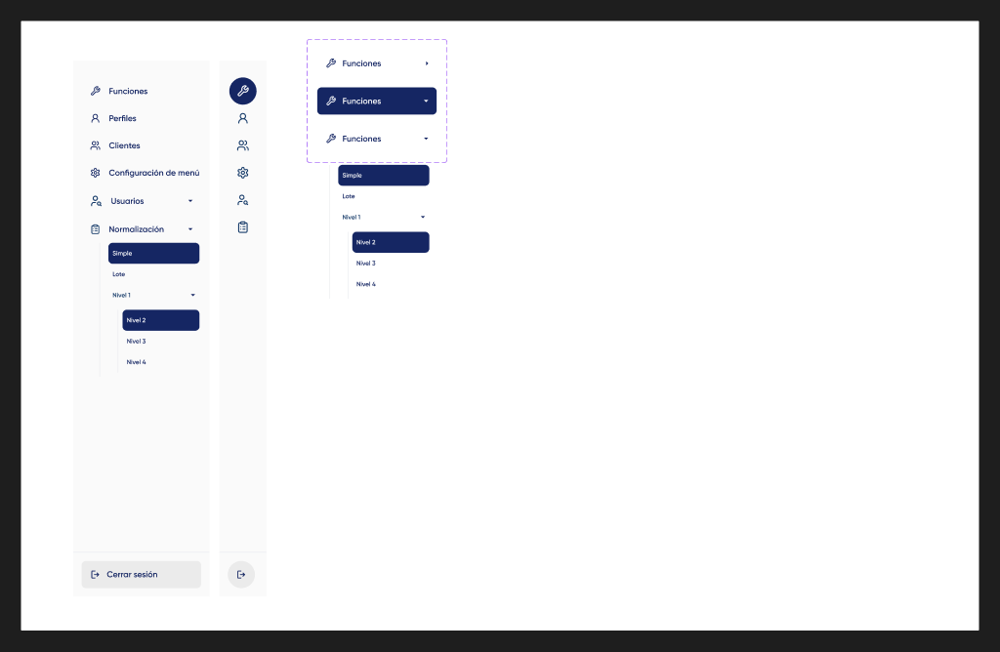
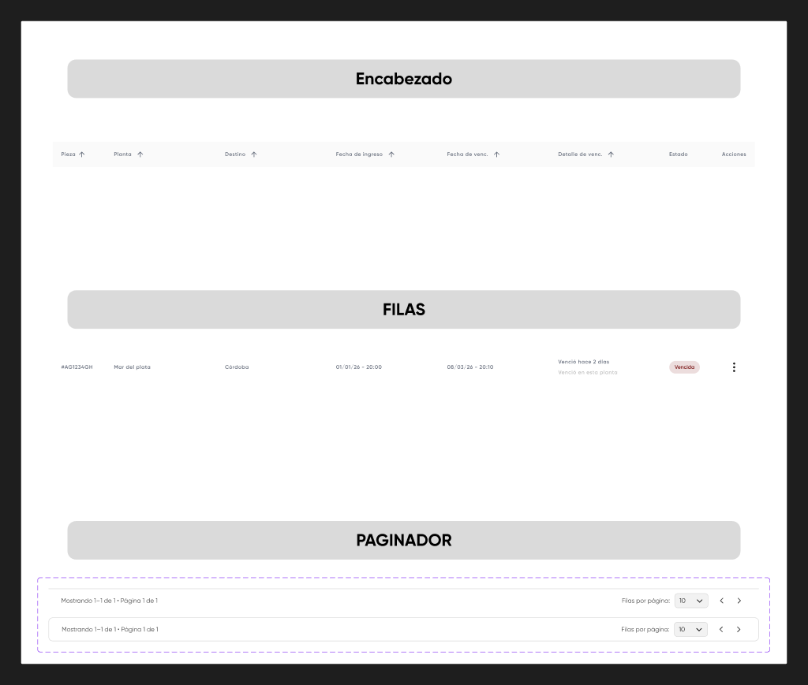
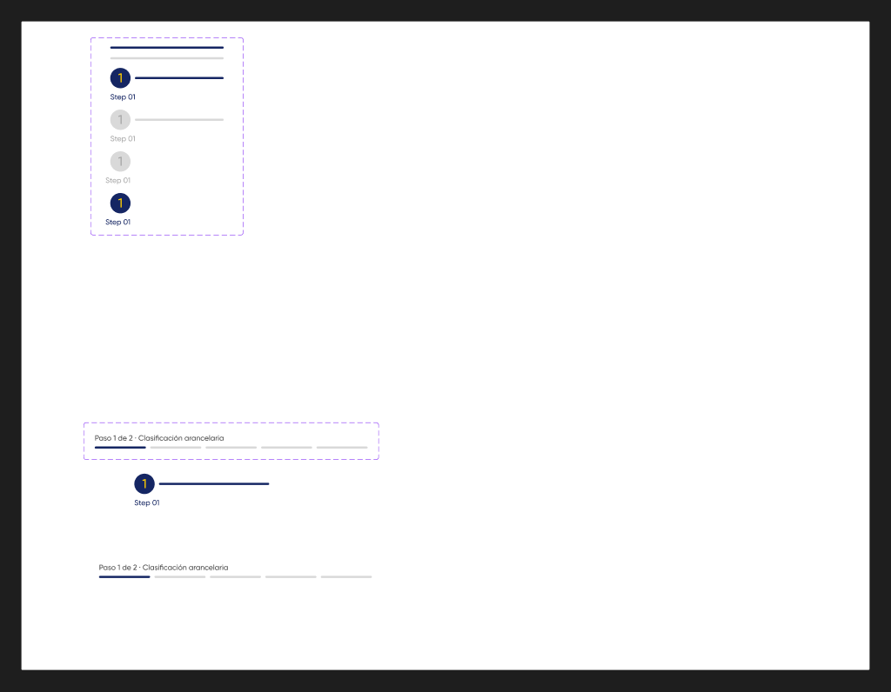

# Header, menú lateral, tabla y stepper

## Header

**Figma:** `Header-base` · [367:3397](https://www.figma.com/design/kOuwVxF91lktyHh1DSVuAr/Design-System?node-id=367-3397) · `Header-MiCorreo` · 837:1725
**MUI:** `<AppBar position="sticky">` + `<Toolbar>`

| Figma `Type` | Alto | Fondo | Contenido |
|---|---|---|---|
| Dekstop-full | 80 | (sin fondo) | título + avatar + nombre y email |
| Dekstop-default | 80 | `#FFCE00` | título SemiBold 20 + avatar + nombre y email |
| Dekstop-base | 80 | `#FFCE00` | ídem |
| Tablet-Mobile | 60 | `#FFCE00` | título SemiBold 16 + avatar; padding 0/16/0/24 |

Avatar: inicial en Gilroy SemiBold 14. ⚠ La variante Tablet-Mobile usa **Inter** en la inicial.

## Menú lateral

**Figma:** `Menú lateral 2.0` · [696:1067](https://www.figma.com/design/kOuwVxF91lktyHh1DSVuAr/Design-System?node-id=696-1067) (actual) · `Menú lateral 1.0` · 220:1802 (anterior; incluye `Sidebar-MiCorreo`)
**MUI:** `<Drawer variant="permanent">` + `<List>` + `<ListItemButton>`

`Opciones sideBar` (696:1110): ítem de 228×52, padding 16, separación 12, radio 8, Gilroy SemiBold 16.
- `active=true` → `selected`: fondo `#152663`, texto e ícono blancos.
- `collapsed=true` → Drawer angosto, sólo ícono (usar `Tooltip` con el nombre).
- `show left/right icon` → `ListItemIcon` / chevron para submenú (`Collapse`).

## Tabla

**Figma:** `Componente tablas` · [367:2110](https://www.figma.com/design/kOuwVxF91lktyHh1DSVuAr/Design-System?node-id=367-2110) · `Header tabla` 367:1897 · `Filas tablas` 367:1898 · `Paginador tablas` 1562:1461
**MUI:** `<Table>` / `<TableContainer>` o `@mui/x-data-grid` si ya lo usan · `<TablePagination>`

Paginador: alto 45, padding 12/24, separación 24, Gilroy Regular 12, fondo blanco, borde `#D9D9D9`. Variante `borders` = con radio 8 y borde completo.
Texto: "Mostrando 1–1 de 1 • Página 1 de 1" / "Filas por página:" → `labelDisplayedRows` y `labelRowsPerPage` en español.

## Stepper

**Figma:** `Steppers` · [1639:1489](https://www.figma.com/design/kOuwVxF91lktyHh1DSVuAr/Design-System?node-id=1639-1489) · `Mini step` 1639:1499 · `steps mini stepper` 1639:1502
**MUI:** no coincide con `<Stepper>` por defecto → componente propio sobre `<Stack>` + `<LinearProgress variant="determinate">` o barras simples.

| `version` | Descripción |
|---|---|
| mini | barra de 4 px de alto, radio 2; completa `#152663`, pendiente `#D9D9D9` |
| expanded | número (Gilroy Medium 24) + nombre del paso (Medium 14) arriba de la barra |
| expan end / z | paso final angosto (38 px) |

Hasta 5 pasos (`Step 01`…`Step 05`) con título opcional.
