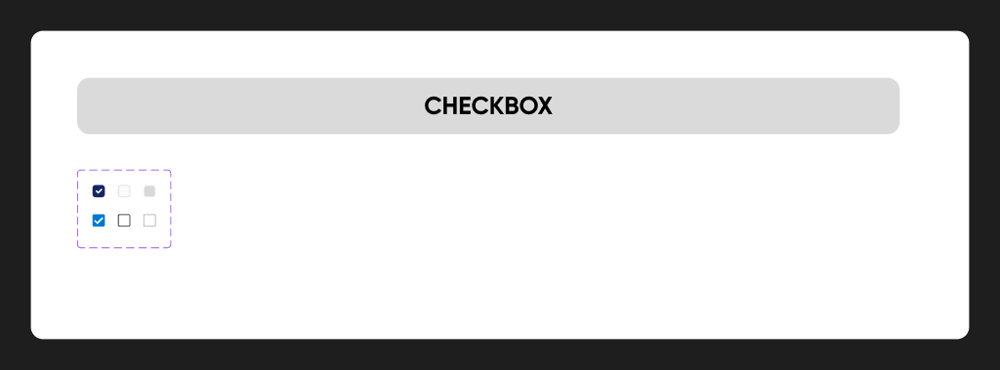
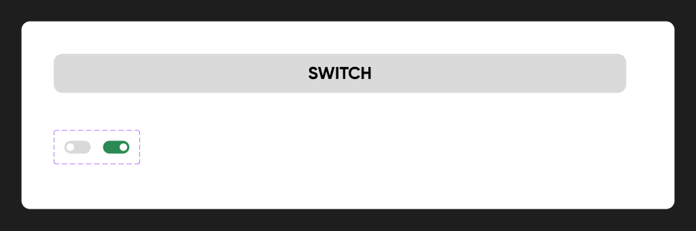

# Checkbox, Radio y Switch

## Checkbox

**Figma:** `Checkbox` · [231:940](https://www.figma.com/design/kOuwVxF91lktyHh1DSVuAr/Design-System?node-id=231-940) · **MUI:** `<Checkbox>` (el theme reemplaza el ícono)

| Estado | v2 (actual) | v1 "Correo 1.5" (producción) |
|---|---|---|
| Default | 16×16, radio 4, fondo `#FAFAFA`, borde `#D9D9D9` | radio 2, fondo blanco, borde `#191919` |
| Active | fondo `#152663` + tilde blanco | fondo `#0078D4` ⚠ (no es token) |
| Disabled | fondo `#D9D9D9`, borde `#FAFAFA` | borde `#A7A7A7` |

El theme implementa la **v2**. Con label: `<FormControlLabel control={<Checkbox />} label="Acepto" />`.

## Radio

**Figma:** `Radio buttons` · [231:829](https://www.figma.com/design/kOuwVxF91lktyHh1DSVuAr/Design-System?node-id=231-829) · **MUI:** `<Radio>` dentro de `<RadioGroup>`

| Estado | Color |
|---|---|
| Default | `#D9D9D9` |
| Activ(e) | `#152663` |
| Disabled | `#D9D9D9` ⚠ igual a Default |

Tamaño: caja de 24 con círculo de 20 (similar al ícono de MUI).

## Switch

**Figma:** `Switch` · [35:262](https://www.figma.com/design/kOuwVxF91lktyHh1DSVuAr/Design-System?node-id=35-262) · **MUI:** `<Switch>`

| | Valor |
|---|---|
| Tamaño | 49×24, pill |
| Off | pista `#D9D9D9` |
| On | pista `#2A8A54` (verde success) |
| Thumb | blanco, 16 px, padding 4 |

⚠ Figma no define el estado disabled ni el foco.
