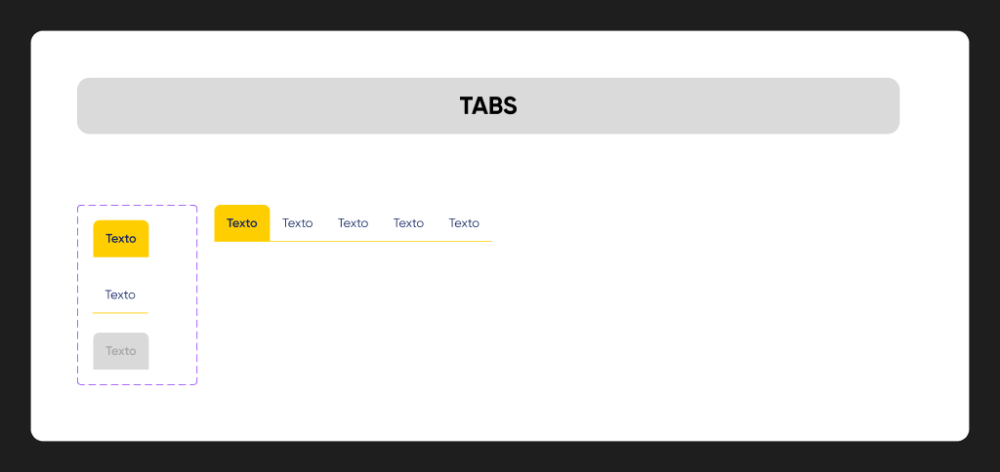
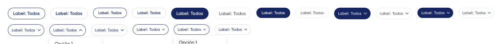

# Tabs y Chip

## Tabs

**Figma:** `Tabs` · [151:721](https://www.figma.com/design/kOuwVxF91lktyHh1DSVuAr/Design-System?node-id=151-721) / `Tabs-individual` · [151:709](https://www.figma.com/design/kOuwVxF91lktyHh1DSVuAr/Design-System?node-id=151-709)
**MUI:** `<Tabs>` + `<Tab>` (el theme oculta el indicador)



| Estado | Fondo | Texto |
|---|---|---|
| Active | `#FFCE00`, esquinas superiores redondeadas 8 | Gilroy SemiBold 16, `#191919` |
| Default | transparente | Gilroy Regular 16, `#152663` |
| Disabled | `#D9D9D9` | `#A7A7A7` |

Alto 48, padding 16. Línea inferior del grupo: 1px `#D9D9D9`.
⚠ En Figma el borde del Tab Default usa una variable llamada `input-stroke-default` que apunta a amarillo. En la vista agrupada la línea se ve gris; se tomó el gris.

## Chip

**Figma:** `Chip` · [1669:1565](https://www.figma.com/design/kOuwVxF91lktyHh1DSVuAr/Design-System?node-id=1669-1565) · 18 variantes · tiene descripción de uso en Figma
**MUI:** `<Chip>` (Standard / light) · para `Select` / `Select light` → `<Chip>` + `<Menu>`



| Figma | MUI | Estilo |
|---|---|---|
| Standard, isActive=true | `variant="filled" color="secondary"` | fondo `#152663`, texto blanco SemiBold |
| Standard, isActive=false | `variant="outlined"` | fondo blanco, borde `#E5E7EC` ⚠, texto Medium |
| light, isActive=true | `variant="outlined" color="secondary"` | fondo blanco, borde `#152663` |
| light, isActive=false | `variant="outlined"` | fondo blanco, borde `#D9D9D9` |
| Select / Select light | Chip clickeable + `<Menu>` | ícono chevron a la derecha, padding 10/8/10/12 |

| Figma `Size` | MUI `size` | Alto | Texto |
|---|---|---|---|
| M | `medium` | 36 | 14 |
| S | `small` | 32 | 12 |

Padding 10/16, radio pill, separación 4.

Propiedades: `Text` / `Selected` → `label`; `Show Label` + `label prop` → prefijo "Label: "; `Show Count` + `Count` → badge numérico dentro del label; `Show Icon Left/Right` → `icon` / `deleteIcon`.

```tsx
<Chip label="Todos" color="secondary" />                       {/* Standard activo */}
<Chip label="Estado: Todos" variant="outlined" onClick={openMenu}
      deleteIcon={<ChevronDown />} onDelete={openMenu} />      {/* Select */}
```

⚠ `#E5E7EC` (`color-border-subtle`) no existe en las variables del archivo: viene de otra librería. Se propone reemplazarlo por `#D9D9D9`.
